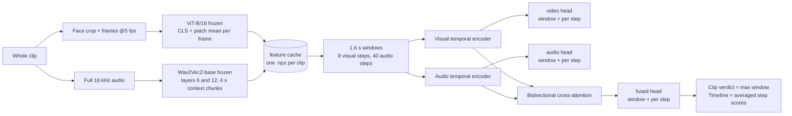

# FusionTrace: audio-visual deepfake detection and localisation

<p align="center">
  
  
  
  
  
</p>

FusionTrace scores **every 1.6 second window of a whole clip** with three heads
(video only, audio only, fused cross-attention) and predicts, for every 0.2 s
frame step and every 40 ms audio step inside the window, whether it is
manipulated. The result is a verdict for the clip **and a timeline that shows
where it is fake and by which modality**.

## Why the project was rebuilt

The first version (now in `legacy/`) classified a clip from 8 frames and the
first 4 s of audio and reached 97.65 % test accuracy on LAV-DF. Its own
diagnostics (`results/shortcut_check`, `legacy/evaluation/shortcut_check.py`)
showed that number was not measuring deepfake detection:

- swapping a fake clip's audio with the untouched source audio changed the
  prediction by 0.0000 - the model ignored audio entirely;
- fakes whose manipulated segment was never shown to the model were flagged
  just as often as fakes where it was - the model used a per-file cue, not the
  manipulation.

The rebuilt pipeline fixes the causes: it sees the **whole** clip, labels are
assigned **per window and per step** from the annotated fake periods (a clean
window inside a fake clip is REAL, an audio-only fake has `video_fake = 0`,
`audio_fake = 1`), training is **balanced** across real / video-only /
audio-only / both, and the modality swap check is a standard part of
evaluation.

## Research question

> Does bidirectional cross-attention between visual and audio representations
> detect and localise manipulations better than unimodal models and simple
> concatenation?

The same training script runs all four variants (`train.fusion =
cross_attention | concat | video_only | audio_only`) on identical windows, so
the comparison is one config flag.

## Architecture



The encoders are **frozen** by default. That does not change the architecture:
the layers and shapes are identical, only the weights stop receiving gradient.
It is what makes training on all 325 hours of LAV-DF feasible on a 4 GB laptop
GPU: the encoders run once (`build_cache.py`), after that an experiment over
40 000 balanced windows takes minutes, not days. `train.source=raw` together
with `train.trainable_video_blocks` / `train.trainable_audio_blocks` fine-tunes
the top transformer blocks end to end from the mp4 files once the fusion
design is settled.

Window labels (see `fusiontrace/windows.py`): a window is positive for a fake
period when it overlaps it by at least `min(0.2 s, 50 % of the period)`,
negative when it does not touch it, and *ambiguous* (excluded from training)
in between. LAV-DF fake periods average 0.65 s and 90 % are shorter than 1 s.

## Layout

```
fusiontrace/        library: config, media decoding, face crop, windows, encoders,
                    cache, datasets, model, metrics, evaluation, inference
scripts/            build_cache.py  train.py  evaluate.py  analyze_video.py  make_smoke_data.py
configs/            default.yaml (all knobs, documented)  smoke.yaml
dashboard/          local web dashboard with timeline (python dashboard/app.py)
tests/              unit tests + optional end-to-end smoke test
preprocessing/      create_metadata.py (LAV-DF json -> metadata/lavdf_metadata.csv)
metadata/           lavdf_metadata.csv
results/            legacy error analyses, shortcut check; runs/ and eval/ are created by the scripts
legacy/             first-phase scripts, models and dashboards (see legacy/README.md)
src/, index.html    React front end (FusionTrace UI); can call the dashboard JSON API
```

## Setup

```powershell
pip install -r requirements.txt
# ffmpeg must be on PATH (or rely on imageio-ffmpeg). The YuNet face detector
# (230 KB) is downloaded once into ~/.cache/fusiontrace.
set LAVDF_ROOT=C:\AI_DATA\LAV-DF\LAV-DF        # or data.dataset_root in the config
```

## Run

```powershell
# 0. (once) metadata csv from LAV-DF's metadata.min.json
python preprocessing\create_metadata.py

# 1. cache the frozen encoder features (resumable; ~50 clips/min on an RTX 3050)
python scripts\build_cache.py --splits train --max-videos 25000 --seed 42
python scripts\build_cache.py --splits dev test --max-videos 5000 --seed 42

# 2. train (results/runs/<name>/, best checkpoint copied to results/runs/latest/)
python scripts\train.py --name xattn
python scripts\train.py --name concat     --set train.fusion=concat
python scripts\train.py --name video_only --set train.fusion=video_only
python scripts\train.py --name audio_only --set train.fusion=audio_only

# 3. evaluate on the cached test clips, with the modality swap check
python scripts\evaluate.py --checkpoint results\runs\xattn\best.pt --split test --swap

# 4. analyse any video and plot its timeline
python scripts\analyze_video.py some_video.mp4 --plot timeline.png --json result.json

# 5. dashboard
python dashboard\app.py
```

Cache size is about 0.8 MB per clip (0.74 for train clips): 25 000 clips need
20 GB, the full 136 304 clips 110 GB. Set `data.audio_layers: [8]` and
`data.audio_pool: 4` to cut that by roughly 3x if disk is short.

## What the evaluation reports

`scripts/evaluate.py` writes `results/eval/<run>_<split>/metrics.json` with:

- **video level**: AUC, average precision, balanced accuracy, precision /
  recall / F1 and false-positive rate at the threshold chosen on dev;
- **per fake type**: share of real / video-only / audio-only / both clips that
  are flagged, and the mean score of the video head and the audio head on each
  type (modality attribution);
- **window level**: AUC of the fused, video and audio heads;
- **localisation**: frame-level AUC of the dense curve, segment AP at IoU 0.5 /
  0.75 / 0.95 (threshold-free proposals with NMS, the LAV-DF protocol);
- **modality swap** (`--swap`): mean score when a fake clip's frames or audio
  are replaced with the untouched source clip.

LAV-DF test is 73.5 % fake, so plain accuracy is not reported on its own.

## Tests

```powershell
python -m pytest tests -q                       # unit tests, seconds
set FUSIONTRACE_SMOKE=1 && python -m pytest tests -q -k pipeline   # synthetic clips end to end
```

`scripts/make_smoke_data.py` generates cartoon talking heads whose mouth
follows the audio envelope, with video / audio / both manipulations inside
annotated periods, so the whole pipeline can be exercised without the dataset.

## Status

- Pipeline verified end to end on synthetic data (CPU) and on a LAV-DF sample
  (3,000 train / 600 dev / 1,000 test clips) on the GPU. All four variants were
  trained and evaluated; see `results/lavdf_sample_run/README.md` for the numbers
  and what they do and do not show.
- Full LAV-DF cache and the four-variant comparison at full scale are the next
  step; see the commands above.
- End-to-end fine-tuning (`train.source=raw`) is implemented and smoke-tested
  but has not been run at scale.
- Cross-dataset evaluation on FakeAVCeleb is not done yet. The pipeline only
  needs a metadata csv in the same format (`file, split, modify_video,
  modify_audio, duration, fake_periods`), then `build_cache.py` and
  `evaluate.py` work unchanged.
