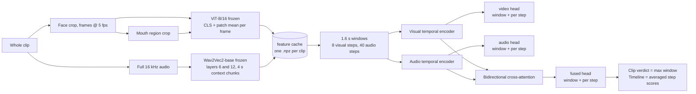

# FusionTrace: audio-visual deepfake detection and localisation

<p align="center">
  
  
  
  
  
</p>

FusionTrace takes a video, scores **every 1.6 second window of the whole clip**
with three heads (video only, audio only, fused cross-attention) and predicts,
for every 0.2 s frame step and every 40 ms audio step inside the window, whether
it is manipulated. The result is a verdict for the clip **and a timeline that
shows where it is fake and by which modality**.

This file is the single place to read: what the model does, how every piece
works, how to run it on Windows step by step, where to change settings, and how
much disk and time each step needs.

---

## Contents

1. [Why the project was rebuilt](#1-why-the-project-was-rebuilt)
2. [How the model works](#2-how-the-model-works)
3. [Repository layout](#3-repository-layout)
4. [Setup on Windows (one time)](#4-setup-on-windows-one-time)
5. [Running the pipeline, step by step](#5-running-the-pipeline-step-by-step)
6. [Where to change what](#6-where-to-change-what)
7. [Storage and time planner](#7-storage-and-time-planner)
8. [Reading the results](#8-reading-the-results)
9. [Current results](#9-current-results)
10. [Troubleshooting](#10-troubleshooting)
11. [Status and next steps](#11-status-and-next-steps)

---

## 1. Why the project was rebuilt

The first version (now in `legacy/`) classified a clip from 8 frames and the
first 4 s of audio and reached 97.65 % test accuracy on LAV-DF. Its own
diagnostics (`results/shortcut_check`, `legacy/evaluation/shortcut_check.py`)
showed that number was not measuring deepfake detection:

- swapping a fake clip's audio with the untouched source audio changed the
  prediction by 0.0000, so the model ignored audio entirely;
- fakes whose manipulated segment was never shown to the model were flagged
  just as often as fakes where it was, so the model used a per-file cue, not
  the manipulation.

The rebuilt pipeline fixes the causes. It sees the **whole** clip, labels are
assigned **per window and per step** from the annotated fake periods (a clean
window inside a fake clip is REAL; an audio-only fake has `video_fake = 0`,
`audio_fake = 1`), training is **balanced** across real / video-only /
audio-only / both, the fused head is trained with **modality dropout** so it
cannot rely on one stream, and the modality swap check is a standard part of
evaluation.

### Research question

> Does bidirectional cross-attention between visual and audio representations
> detect and localise manipulations better than unimodal models and simple
> concatenation?

The same training script runs all four variants (`train.fusion =
cross_attention | concat | video_only | audio_only`) on identical windows, so
the comparison is one config flag.

---

## 2. How the model works

### 2.1 Pipeline



**Step 1, decoding (`fusiontrace/media.py`, `fusiontrace/faces.py`).** The
clip is decoded once at 5 frames per second. A YuNet face detector finds the
face on a few probe frames; the median box is applied to every frame (talking
heads barely move) and the crop is resized to 224x224. From the face crop a
second **mouth stream** is cut: a square around the mouth corners returned by
the same detector (lower face, roughly 35-70 % of the frame side), also
resized to 224x224. Lip-sync manipulations only change the lower face, so the
ViT sees that region at full resolution instead of as a few patches. If no
landmarks are found, the lower-centre of the frame is used. The full audio
track is read as 16 kHz mono with ffmpeg.

**Step 2, frozen encoders (`fusiontrace/encoders.py`).** Every face frame and
every mouth frame goes through the pretrained ViT-B/16; per frame we keep the
CLS token and the mean of the patch tokens for each stream (2 x 768 x 2 streams
= 3072 numbers per frame). The audio goes through pretrained Wav2Vec2-base in
4 s chunks with a 3.2 s hop; only the central tokens of each chunk are kept so
a fake segment at 5 s cannot leak into the features at 1 s. Hidden states of
layers 6 and 12 are kept and pooled from 50 Hz to 25 Hz (2 x 768 numbers per
40 ms step). Both encoders are frozen: the architecture is unchanged, only the
weights stop receiving gradient. This is what makes training on all of LAV-DF
feasible on a 4 GB laptop GPU: the encoders run once (`build_cache.py`), and
after that an experiment over 40,000 windows takes about 40 s per epoch.

**Step 3, the cache (`fusiontrace/cache.py`).** One `.npz` per clip holding
`visual [T_v, 3072]`, `audio [2, T_a, 768]` in float16 plus the rates and the
duration. `manifest.json` records the settings the cache was built with; the
scripts refuse to mix settings in one cache directory.

**Step 4, windows and labels (`fusiontrace/windows.py`, `fusiontrace/data.py`).**
Windows of 1.6 s are enumerated over each clip (stride 0.4 s for training,
0.2 s for evaluation). A window is *positive* for a fake period when it
overlaps it by at least `min(0.2 s, 50 % of the period)`, *negative* when it
does not touch it, and *ambiguous* (excluded from training) in between. The
per-modality labels combine that with the file flags: `video_fake =
modify_video and positive`, `audio_fake = modify_audio and positive`,
`any_fake = video_fake or audio_fake`. Per-step targets mark the steps whose
centre lies inside a fake period. Training draws a **balanced** sample of
windows: 25 % real, 25 % video-only, 25 % audio-only, 25 % both. LAV-DF fake
periods average 0.65 s and 90 % are shorter than 1 s, hence the 1.6 s window.

**Step 5, the fusion model (`fusiontrace/model.py`, 4.3 M parameters).** Each
stream is projected to 256 dimensions, gets sinusoidal positions and passes a
one-layer transformer encoder. The **video head** and **audio head** are read
from these unimodal sequences *before* any cross-modal exchange, so they stay
honest single-modality detectors. Then a bidirectional cross-attention block
lets the visual tokens attend over the audio tokens and vice versa; the pooled
results are concatenated into the **fused head**. Every head exists twice: one
logit for the window and one logit per step (for localisation). `fusion =
concat` replaces cross-attention by concatenation, `video_only` /
`audio_only` drop a stream entirely.

**Step 6, training (`scripts/train.py`).** Binary cross-entropy on all six
heads, AdamW, warm-up plus cosine schedule, mixed precision on the GPU.
**Modality dropout** (`train.modality_dropout: 0.3`): for 30 % of the training
windows one modality is zeroed (half the time audio, half the time video), the
fused targets become the labels of the remaining modality, and the head of the
missing modality is skipped in the loss. Without this the fused head solves
LAV-DF from the audio alone and never learns to use the frames (see section 9).
After every epoch the dev clips are scored; the clip threshold (balanced
accuracy) and the step threshold (F1 on the dense curve) are chosen on dev and
stored in the checkpoint, and `best.pt` is kept by dev video AUC.

**Step 7, inference (`fusiontrace/inference.py`, `fusiontrace/evaluation.py`).**
All windows of a clip are scored. Clip score = the maximum fused window score;
verdict = DEEPFAKE if it passes the dev threshold. The per-step probabilities
of overlapping windows are averaged onto one time grid per head, giving the
timeline; runs above the step threshold become flagged segments, and each
segment is attributed to video, audio, or both by comparing the unimodal
curves inside it. A clip without an audio track gets zero audio features, the
same representation modality dropout used in training, so the fused head
falls back to the visual evidence.

### 2.2 What the evaluation reports

`scripts/evaluate.py` writes `results/eval/<run>_<split>/metrics.json` with:

- **video level**: AUC, average precision, balanced accuracy, precision /
  recall / F1 and false-positive rate at the threshold chosen on dev;
- **per fake type**: share of real / video-only / audio-only / both clips that
  are flagged, and the mean score of the video head and the audio head on each
  type (modality attribution);
- **window level**: AUC of the fused, video and audio heads;
- **localisation**: frame-level AUC of the dense curve, segment AP at IoU 0.5 /
  0.75 / 0.95 (threshold-free proposals with NMS, the LAV-DF protocol);
- **modality swap** (`--swap`): mean score when a fake clip's frames or audio
  are replaced with the untouched source clip. A model that uses both streams
  drops when the manipulated stream is swapped out and stays when the untouched
  stream is swapped out.

LAV-DF test is 73.5 % fake, so plain accuracy is never reported on its own.

---

## 3. Repository layout

```
fusiontrace/        library: config, media decoding, face + mouth crop, windows, encoders,
                    cache, datasets, model, metrics, evaluation, inference
scripts/            build_cache.py  train.py  evaluate.py  analyze_video.py  make_smoke_data.py
configs/            default.yaml (every knob, documented)  smoke.yaml (tiny settings for tests)
dashboard/          local web dashboard with timeline (python dashboard\app.py)
tests/              unit tests + optional end-to-end smoke test on synthetic clips
preprocessing/      create_metadata.py (LAV-DF json -> metadata/lavdf_metadata.csv)
metadata/           lavdf_metadata.csv (already generated, 136,304 clips)
results/            lavdf_sample_run/ (numbers from the sample run), legacy error analyses,
                    shortcut check; runs/ and eval/ are created by the scripts (git-ignored)
legacy/             first-phase scripts, models and dashboards (see legacy/README.md)
src/, index.html    React front end (FusionTrace UI). Demo only: it does not call the model.
```

Outputs created while running (all git-ignored):

```
<cache_dir>/manifest.json, <cache_dir>/<split>/<clip>.npz      feature cache (section 5.2)
results/runs/<name>/config.yaml, train.log, history.json, last.pt, best.pt
results/runs/latest/best.pt + source.json                      best cross-attention / concat run so far
results/eval/<run>_<split>/metrics.json, video_predictions.csv, window_predictions.csv, modality_swap.csv
dashboard/runtime/<run_id>/                                    uploads, thumbnails, timeline.png
```

---

## 4. Setup on Windows (one time)

Everything below is PowerShell, run from the project folder
(`C:\Users\Karan singh\OneDrive\Desktop\major project`). Open the folder in
VS Code or Explorer, right-click, "Open in Terminal".

### 4.1 Python environment

The folder already contains `.venv` (Python 3.12, PyTorch 2.14 with CUDA 13.0,
transformers, OpenCV 5, scikit-learn, PyYAML, matplotlib). Activate it:

```powershell
.\.venv\Scripts\Activate.ps1
```

If PowerShell refuses to run the activation script, allow scripts for the
current user once:

```powershell
Set-ExecutionPolicy -Scope CurrentUser RemoteSigned
```

Install the two packages that are still missing (the test runner and a
bundled ffmpeg fallback):

```powershell
pip install pytest imageio-ffmpeg
```

Starting from an empty machine instead? Create the environment and install
PyTorch **with CUDA first**, then the rest; `pip install torch` alone would
give you the CPU build:

```powershell
py -3.12 -m venv .venv
.\.venv\Scripts\Activate.ps1
pip install torch torchaudio --index-url https://download.pytorch.org/whl/cu126
pip install -r requirements.txt
```

Check that the GPU is seen (expected: `2.14.x+cu130 True NVIDIA GeForce RTX 3050 Laptop GPU`):

```powershell
python -c "import torch; print(torch.__version__, torch.cuda.is_available(), torch.cuda.get_device_name(0))"
```

### 4.2 ffmpeg

`ffmpeg` is on PATH on this machine (`C:\ffmpeg\ffmpeg\bin`). On another
machine either install ffmpeg or rely on `imageio-ffmpeg`, which the code uses
automatically when `ffmpeg` is not found.

### 4.3 Dataset location

The code looks for LAV-DF in this order: `data.dataset_root` in the config,
the `LAVDF_ROOT` environment variable, then `datasets\LAV-DF\LAV-DF` inside the
project, then `C:\AI_DATA\LAV-DF\LAV-DF`. Your copy is at
`C:\AI_DATA\LAV-DF\LAV-DF`, so nothing needs to be set. To use a different
disk, set the variable for the session:

```powershell
$env:LAVDF_ROOT = "D:\LAV-DF\LAV-DF"
```

### 4.4 Pretrained encoders

ViT-B/16 and Wav2Vec2-base are downloaded from the Hugging Face Hub the first
time they are needed (about 700 MB, into `C:\Users\Karan singh\.cache\huggingface`).
They are already there on this machine. The YuNet face detector (230 KB) is
downloaded once into `C:\Users\Karan singh\.cache\fusiontrace`.

### 4.5 Put the feature cache outside OneDrive

This project folder is inside OneDrive. The feature cache is tens of GB and
would be uploaded to the cloud and slow down every write. Point it to a local
folder once: open `configs\default.yaml` and change line 7

```yaml
  cache_dir: data/features        # per-video frozen encoder features
```

to

```yaml
  cache_dir: C:/AI_DATA/fusiontrace/features
```

(forward slashes are fine). Every script then reads and writes the cache
there. Alternatively add `--set data.cache_dir=C:/AI_DATA/fusiontrace/features`
to every command, but editing the file once is less error-prone.

### 4.6 Check the installation

```powershell
python -m pytest tests -q
```

Expected: `18 passed, 1 skipped` in a few seconds (the skipped one is the slow
end-to-end test). To also run the pipeline end to end on synthetic cartoon
clips (downloads nothing new, takes 3-5 minutes on the GPU):

```powershell
$env:FUSIONTRACE_SMOKE = "1"; python -m pytest tests -q -k pipeline
```

---

## 5. Running the pipeline, step by step

Each command is given with what it does, what it writes and how long it takes
on the RTX 3050 (4 GB). Run them in order. All of them accept `--help`.

### 5.1 Metadata (already done)

`metadata\lavdf_metadata.csv` is in the repository (one row per clip: file,
split, label, modify_video, modify_audio, duration, source clip, fake periods).
Only regenerate it if the dataset changes:

```powershell
python preprocessing\create_metadata.py
```

### 5.2 Build the feature cache

This is the slow step and the one that uses disk. It runs the frozen encoders
over every selected clip and stores the features. It is **resumable**: clips
that are already cached are skipped, so you can stop it (Ctrl+C) and rerun the
same command later.

**Start with 25,000 training clips** (random subset, fixed seed, so it is
reproducible) and 5,000 dev and 5,000 test clips:

```powershell
python scripts\build_cache.py --splits train --max-videos 25000 --seed 42 --workers 3
python scripts\build_cache.py --splits dev test --max-videos 5000 --seed 42 --workers 3
```

- `--splits`: which splits to cache. `--max-videos N`: random subset of N clips
  per split (omit it for the whole split). `--seed`: makes the subset
  reproducible; keep 42 so later runs pick the *same* clips and nothing is
  cached twice. `--workers`: CPU processes that decode video while the GPU
  encodes; 3 is right for this laptop, lower it if the machine becomes
  unresponsive.
- Progress is printed every 50 clips with the rate, MB per clip and an ETA.
  Decoding failures (if any) are written to `<cache_dir>\errors.log` and do not
  stop the run.
- Writes: about 0.9 MB per clip. 25,000 + 5,000 + 5,000 clips = about 32 GB.
  Time: see section 7.

**Later, for full training**, run the same commands without `--max-videos`.
Already-cached clips are skipped, so only the remaining clips are processed:

```powershell
python scripts\build_cache.py --splits train dev test --workers 3
```

Full LAV-DF is 136,304 clips, about 120 GB of cache. If that is too much,
section 7 shows how to cut the cache size before building it.

### 5.3 Train

```powershell
python scripts\train.py --name xattn_25k
```

- Reads `configs\default.yaml`; `--name` sets the run folder
  `results\runs\xattn_25k`. Without `--name` a timestamped name is used.
- Trains on **every train clip that is in the cache** and scores up to 2,000
  cached dev clips after each epoch (`train.max_dev_videos`).
- Prints per-epoch loss and the dev metrics; writes `history.json`,
  `train.log`, `last.pt` (for resuming) and `best.pt` (best dev video AUC).
  When this run is the best cross-attention / concat run so far it is also
  copied to `results\runs\latest\best.pt`, which the dashboard uses by default.
  Unimodal ablations never replace `latest`.
- Time: about 40 s per epoch plus about 1 min of dev scoring, 8 epochs by
  default, so roughly 15 minutes. The epoch length is a fixed number of
  windows (`train.windows_per_epoch: 40000`), so it does not grow with the
  cache; with 25,000 clips give it more epochs instead (section 6).

The ablations are the same command with one flag each:

```powershell
python scripts\train.py --name concat_25k     --set train.fusion=concat
python scripts\train.py --name video_only_25k --set train.fusion=video_only
python scripts\train.py --name audio_only_25k --set train.fusion=audio_only
```

Resume an interrupted run (continues from the saved epoch with the same
optimiser state):

```powershell
python scripts\train.py --name xattn_25k --resume results\runs\xattn_25k\last.pt
```

### 5.4 Evaluate on the test clips

```powershell
python scripts\evaluate.py --checkpoint results\runs\xattn_25k\best.pt --split test --swap
```

- Scores every cached test clip with the dev thresholds stored in the
  checkpoint (add `--tune-threshold` to pick them on the test set instead,
  which is optimistic and only for diagnosis).
- `--swap` runs the modality swap experiment on up to 200 fakes per type whose
  untouched source clip is also cached (`--swap-per-type` changes the number).
  With a 5,000-clip random test subset about 700 fakes have their source in
  the subset, enough for the default.
- Writes `results\eval\xattn_25k_test\metrics.json`, `video_predictions.csv`
  (one row per clip with the three head scores), `window_predictions.csv`
  (one row per window) and `modality_swap.csv`. Time: 1-3 minutes.

Repeat for the other three runs to fill the comparison table.

### 5.5 Analyse any video

```powershell
python scripts\analyze_video.py "C:\path\to\some_video.mp4" --plot timeline.png --json result.json
```

Prints the verdict, the clip score, the maximum of the video and audio heads
and the flagged segments with their modality; `--plot` writes the timeline
image, `--json` the full result (every window, every curve). Uses
`results\runs\latest\best.pt` unless `--checkpoint` is given. Any resolution
and frame rate works: the face is detected and cropped. About 2-4 s per clip
on the GPU after the models are loaded.

### 5.6 Dashboard

```powershell
python dashboard\app.py
```

Then open <http://127.0.0.1:8501>. Drop a video, press "Analyze video", and
you get the verdict, the three curves over the whole clip, the flagged
segments with modality and a thumbnail each, and a frame strip. Nothing leaves
the machine. `--checkpoint results\runs\<run>\best.pt` chooses another model,
`--port` another port, `--preload` loads the model before serving.

JSON API for other front ends (CORS enabled), documented in `dashboard\README.md`:
`POST /api/upload` (multipart field `video`), `GET /api/status/<run_id>`,
`GET /runs/<run_id>/<file>`.

### 5.7 Tests

```powershell
python -m pytest tests -q                                            # unit tests, seconds
$env:FUSIONTRACE_SMOKE = "1"; python -m pytest tests -q -k pipeline   # synthetic clips end to end
```

`scripts\make_smoke_data.py` generates cartoon talking heads whose mouth
follows the audio envelope, with video / audio / both manipulations inside
annotated periods, so the whole pipeline can be exercised without the dataset.

---

## 6. Where to change what

All settings live in `configs\default.yaml` (every key has a comment). You
can edit the file or override any key on the command line with
`--set section.key=value`, which is recorded in the run's `config.yaml`.

| You want to                                     | Change                                                                                                                 |
| ----------------------------------------------- | ---------------------------------------------------------------------------------------------------------------------- |
| Put the cache on another disk                   | `data.cache_dir` (line 7). Must be set **before** `build_cache.py`; all later scripts read the same key.               |
| Use a different dataset path                    | `data.dataset_root` (line 5) or `$env:LAVDF_ROOT`.                                                                     |
| Cache fewer / more clips                        | `--max-videos N --seed 42` on `build_cache.py` (not in the yaml).                                                      |
| Halve the cache size                            | Before building: `data.audio_layers: [8]` and `data.audio_pool: 4` (audio is 3/4 of the cache). A new `cache_dir` is required if a cache already exists. |
| Go back to the weaker face-only visual stream   | `data.visual_streams: [face]` before building the cache (halves the visual part, ViT runs once per frame).            |
| Train longer                                    | `train.epochs` (8). With 25,000 clips use 15-20. Each epoch is 40,000 windows regardless of the cache size.           |
| Train on a subset of the cached clips           | `train.max_train_videos` (null = all cached).                                                                           |
| Score fewer dev clips per epoch (faster epochs) | `train.max_dev_videos` (2000).                                                                                          |
| Compare fusion variants                         | `train.fusion`: `cross_attention`, `concat`, `video_only`, `audio_only`.                                               |
| Make the fused head use both streams more/less  | `train.modality_dropout` (0.3). 0 turns it off, 0.5 is aggressive.                                                      |
| GPU out of memory while training                | `train.batch_size` (64 -> 32). While evaluating: `eval.batch_windows` (256 -> 128).                                   |
| Change the window                               | `window.seconds` (1.6), `window.train_stride_seconds` (0.4), `window.eval_stride_seconds` (0.2). No cache rebuild needed. |
| Change the labelling tolerance                  | `window.min_overlap_seconds` (0.2), `window.min_overlap_fraction` (0.5).                                               |
| Fewer short false segments / more sensitivity   | `eval.step_threshold_metric`: `f1` (default) or `balanced_accuracy` (lower threshold, more segments). `eval.min_segment_seconds` (0.2). |
| Clip score from several windows instead of max  | `eval.score_pooling: top3`.                                                                                             |
| Fine-tune the top encoder blocks end to end     | `train.source=raw`, `train.trainable_video_blocks`, `train.trainable_audio_blocks`, `train.raw_batch_size`. Slow; needs a cached dev split. Dev scoring in this mode still uses the frozen cached features, so its dev numbers are indicative only. |

Example: 25,000 clips, 16 epochs, smaller batch:

```powershell
python scripts\train.py --name xattn_25k --set train.epochs=16 --set train.batch_size=32
```

---

## 7. Storage and time planner

Measured on this laptop (RTX 3050 4 GB, dataset on the C: drive). Caching is
GPU-bound at about 55 clips per minute with the two visual streams; LAV-DF
clips average 8.6 s.

| Cache                                   | Clips   | Disk     | Time at 55 clips/min |
| --------------------------------------- | ------- | -------- | -------------------- |
| 25,000 train + 5,000 dev + 5,000 test   | 35,000  | ~32 GB   | ~11 h                |
| Full train (78,703)                     | 78,703  | ~71 GB   | ~24 h                |
| Full train + dev + test (136,304)       | 136,304 | ~123 GB  | ~41 h                |
| Same with `audio_layers: [8]`, `audio_pool: 4` | 136,304 | ~50 GB | ~41 h            |
| Same, plus `visual_streams: [face]`     | 136,304 | ~38 GB   | ~22 h                |

C: had about 79 GB free when this was written. Things in the project folder
that can be deleted to make room (all git-ignored, nothing in the repository
depends on them):

- `results\checkpoints\` (16 GB): eight 2.3 GB checkpoints of the legacy
  model. Keep `multimodal_25000_2epoch_epoch_2.pth` only if you still want to
  run the legacy dashboard; the others are earlier / smaller runs.
- `datasets\FakeAVCeleb_v1.2.zip` and `datasets\FakeAVCeleb_v1.2\` (13 GB):
  the second dataset, needed only for the cross-dataset step later.
- `data\features` inside the project if you created one before moving the
  cache out of OneDrive.

Training and evaluation are cheap: about 15 minutes per run, 17 MB per
checkpoint, 1-3 minutes per evaluation.

---

## 8. Reading the results

`train.py` prints one block per epoch, for example:

```
epoch 4 DEV | video AUC 1.0000 | AP 1.0000 | bal.acc 0.9989 @thr 0.998 | FPR 0.0000 | flagged by type {'real': 0.0, 'video only': 0.993, 'audio only': 1.0, 'video+audio': 1.0}
            window AUC fused 0.9956 | video head 0.851 | audio head 0.997
            localisation: frame AUC 0.9932 | AP@0.5 0.8214 | AP@0.75 0.4511 | AP@0.95 0.0192 | step thr 0.420
```

- **video AUC / AP**: how well the clip score separates real from fake clips.
- **bal.acc @thr**: balanced accuracy at the threshold chosen on dev; the
  threshold is stored in the checkpoint and reused on test.
- **flagged by type**: share of each clip type called DEEPFAKE. `real` should
  be near 0, the three fake types near 1. If `video only` is high but the
  video head AUC is low, the model is detecting video fakes through their
  audio (see section 9).
- **window AUC, video head, audio head**: window-level separability of each
  head. The unimodal heads tell you what each stream can see on its own.
- **frame AUC, AP@IoU**: localisation quality of the timeline; AP@0.5 is the
  usual headline, AP@0.95 is very strict for 0.65 s segments.

`evaluate.py` prints the same plus the per-type modality attribution and the
swap table. In the swap table, for a model that uses both streams:
`fake frames + source audio` should stay high for video fakes and drop for
audio fakes; `source frames + fake audio` the opposite; `source clip (control)`
should be near 0.

---

## 9. Current results

See `results\lavdf_sample_run\README.md` for the complete tables. Summary of a
sample run (3,000 train / 600 dev / 1,000 test clips, default config, one
seed per variant):

- Window-level AUC is 0.99 and the timelines land on the annotated fake
  periods: detection follows the manipulation now.
- Before the mouth stream and modality dropout, the audio carried almost all
  of the decision: the audio-only variant matched cross-attention, "video
  only" fakes were still flagged 97 % of the time with the real frames swapped
  in, and removing the audio track dropped detection from 100 % to 0 %. The
  cause is in the data: LAV-DF time-edits the audio of "video only" fakes to
  fit the new segment (in 40 of 40 sampled clips the audio differs from the
  source inside the fake period).
- The tables in `results\lavdf_sample_run\README.md` compare the two versions
  (face-only / no dropout, and face + mouth / dropout 0.3) on the same clips.

---

## 10. Troubleshooting

| Symptom                                                              | Cause and fix                                                                                                       |
| -------------------------------------------------------------------- | ------------------------------------------------------------------------------------------------------------------- |
| `Cache at ... was built with different settings`                     | The cache directory already holds features made with other `data.*` settings. Use another `data.cache_dir` or delete the old cache. |
| `Need cached train and dev clips. Run scripts/build_cache.py first.` | No clips of that split in the cache. Check `data.cache_dir` is the same in both commands.                          |
| `LAV-DF dataset directory not found`                                 | Set `$env:LAVDF_ROOT` or `data.dataset_root` (section 4.3).                                                         |
| `torch.cuda.is_available()` is False                                 | CPU build of PyTorch installed. Reinstall with the CUDA index URL (section 4.1).                                    |
| CUDA out of memory                                                   | Lower `train.batch_size`, `eval.batch_windows`; close other GPU programs (browsers use VRAM too).                  |
| Caching is very slow                                                 | It is GPU-bound (~55 clips/min). `--workers` above 3 does not help; check nothing else uses the GPU.               |
| `ffmpeg was not found`                                               | `pip install imageio-ffmpeg` or install ffmpeg and add it to PATH.                                                  |
| Dashboard says `Checkpoint not found`                                | No `results\runs\latest\best.pt` yet. Train first, or pass `--checkpoint`.                                         |
| Everything flagged REAL on a silent video                            | Expected to work via the video head; if the video head is weak for that clip, the score is low. Check `max_video_head` in the JSON. |
| Windows: `RuntimeError: ... freeze_support()` or spawn errors        | Always run the scripts as files (`python scripts\train.py`), never paste their contents into an interactive session. |
| OneDrive shows thousands of changed files                            | The cache or `results\runs` is inside the synced folder. Move the cache (section 4.5); `results\runs` is small.    |

---

## 11. Status and next steps

- Pipeline verified end to end on synthetic data (CPU) and on a LAV-DF sample
  (3,000 / 600 / 1,000 clips) on the GPU, all four variants, before and after
  the mouth stream and modality dropout. Unit tests: 18.
- Next: the 25,000-clip cache and the four-variant comparison (section 5),
  then the full dataset, each variant with three seeds.
- End-to-end fine-tuning (`train.source=raw`) is implemented and smoke-tested
  but has not been run at scale.
- Cross-dataset evaluation on FakeAVCeleb is not done yet. The pipeline only
  needs a metadata csv in the same format (`file, split, modify_video,
  modify_audio, duration, fake_periods`), then `build_cache.py` and
  `evaluate.py` work unchanged.
- The React front end in `src\` is a visual demo with simulated results; the
  working UI is `dashboard\app.py`. Connecting the React app to the dashboard
  JSON API is the remaining front-end task.
